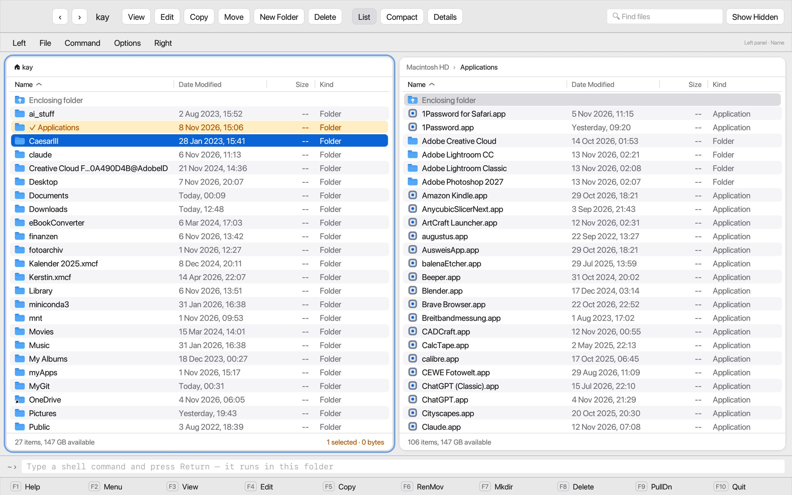

# myCommander

A native macOS two-panel file manager that works like [Midnight Commander](https://midnight-commander.org/) – without the terminal.



## Features

- Two panels, F-key driven copy / move / mkdir / delete, mc's keyboard shortcuts
- Listing formats Full / Brief / Long / User, mc sort modes, marking with size summary
- Quick view shows images (incl. SVG, HEIC, first PDF page) as images, renders Markdown and syntax-highlights source, HTML, shell and config files (themes and language overrides configurable); Info and Tree panel modes; Find file and External panelize
- Internal viewer (text/hex) and editor with selectable text encoding (Left/Right ▸ Encoding…), user menu, directory hotlist, history
- Real macOS menu bar with mc's exact menu structure, light/dark mode, Finder-style list
- Slim toolbar (Find files, Show/Hide Hidden) – everything else is in the menus, keys and function-key bar
- SFTP and FTP in the panels (Left/Right ▸ SFTP link… / FTP link…) using your existing `~/.ssh/config` and keys (SFTP) or `~/.netrc` (FTP) – nothing to set up in myCommander
- Background jobs – the UI never blocks

See [`docs/SPEC.md`](docs/SPEC.md) for the full specification and known limitations.

## Install

Apple Silicon (M-series) Macs only. With [Homebrew](https://brew.sh):

```sh
brew tap say-kaj/tap
brew install --cask mycommander
```

The app tells you about new releases: a **⬆ Update to X.Y.Z** button appears at the right of the toolbar and installs the update inline (switch off in Settings ▸ General). Alternatively `brew update && brew upgrade --cask mycommander`; `brew outdated --cask` shows what is outdated.
Remove with `brew uninstall --cask mycommander` (add `--zap` to delete settings too).

Without Homebrew: download `myCommander-<version>-macos-arm64.zip` from the
[Releases](https://github.com/say-kaj/MyCommander/releases) page, unzip, move `myCommander.app` to
`/Applications` and open it with right-click → Open the first time (the app is ad-hoc signed, not notarized).

## Build and run

Requires macOS on Apple Silicon (M-series, arm64) and a recent stable Rust toolchain. Intel Macs are not supported.

```sh
cargo run --release -- [left-dir] [right-dir]
```

Connect to a server: Left/Right menu ▸ **SFTP link…** and pick a host from your `~/.ssh/config` (keys only, no password prompts –
`ssh <host>` must work in Terminal), or ▸ **FTP link…** (password from `~/.netrc`). You can also start with
`myCommander sftp://host/path`.

Settings are stored in `~/Library/Application Support/myCommander/`.

To build the `.app` bundle and release zip: `scripts/package.sh` (icon: `scripts/make_icon.py`).

## LCARS look

The button **LCARS** next to *Settings* turns myCommander into an LCARS interface (Antonio typeface, elbows and colour segments from the
author's LCARS design system); **CLASSIC** in the same place switches back. Four palettes under Settings ▸ Appearance. See SPEC §15.

## Use it with AI agents (MCP)

myCommander can be driven by AI agents – Claude Code, Claude Desktop, Cursor, VS Code, Codex, Gemini CLI and others – through the
Model Context Protocol. The agent works in the same two panels you see. It is **off by default**: turn it on in
**Settings ▸ General ▸ Remote control** and pick a level (read only, control, or full – with an Allow/Deny question before
every file change). Then register the app with your agent, for example in Claude Code:

```sh
claude mcp add mycommander -- /Applications/myCommander.app/Contents/MacOS/myCommander --mcp
```

The in-app help (**F1 ▸ Remote control**) and [`docs/MCP.md`](docs/MCP.md) explain every step for each agent, the tools, and the
safety model.

## Contributing

Humans and coding agents: read [`docs/SPEC.md`](docs/SPEC.md) and [`AGENTS.md`](AGENTS.md) first.

## License

MIT – see [`LICENSE`](LICENSE).
